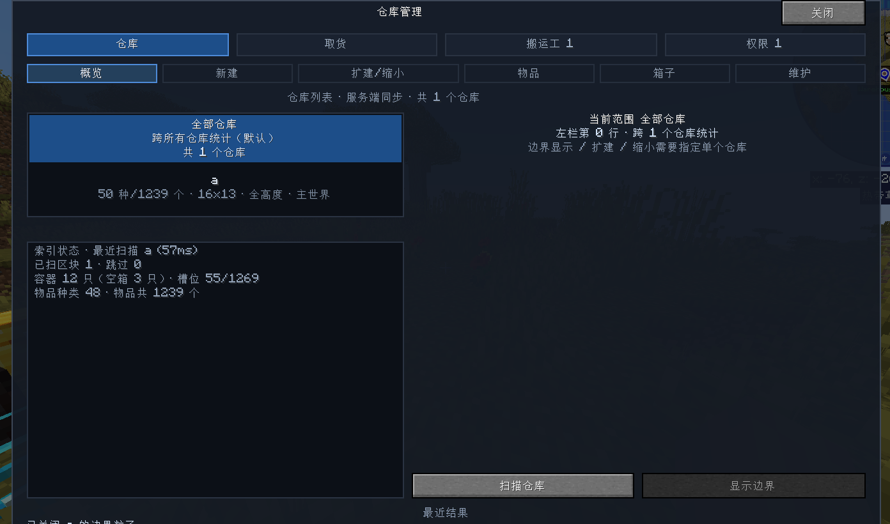
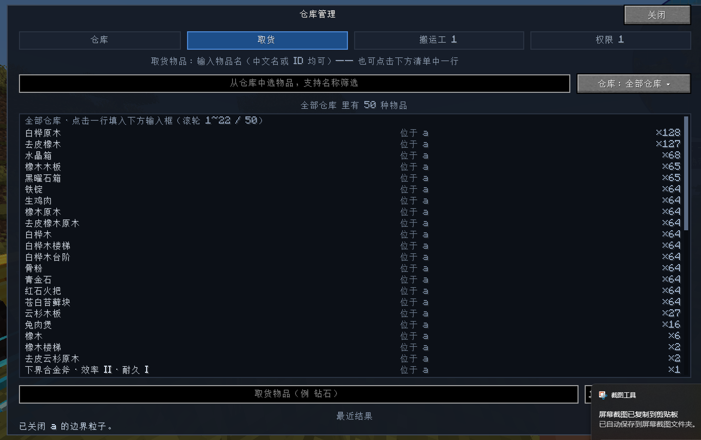
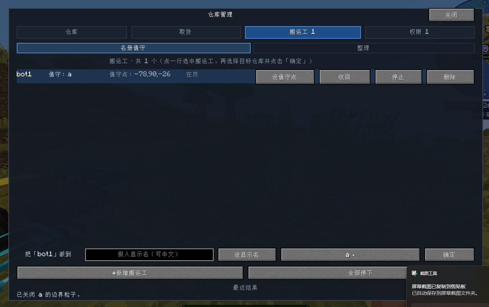
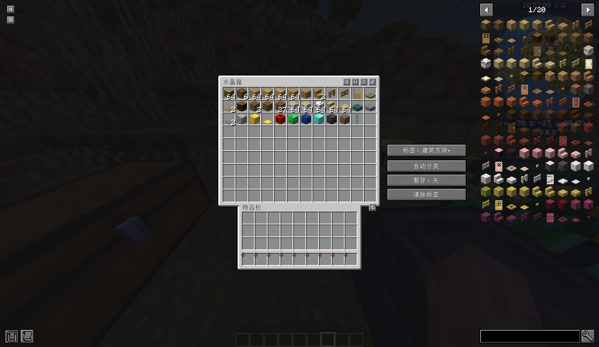

# Warehouse Keeper · 假人仓库管理模组

## 0.Vibe Coding开发声明

这是一个 100% Vibe Coding 项目，所有代码及代码审查均有 AI 负责，人工负责在真机环境下，在真实的游戏存档中测试。

AI 有可能犯错，仅供 vibe coding 学习用途，请勿用于工业生产以及其他重要行业中。若出现任何损失，后果自负！！！

This is a 100% Vibe Coding project. All code and code reviews are handled by AI, while humans are responsible for testing on real devices with real game saves.

AI can make mistakes. It is intended for vibe coding and learning purposes only — do not use it in industrial production or any other critical field. Any losses are your own responsibility!!!

## 1.简介

Warehouse Keeper 是面向 Minecraft 26.3 和 Minecraft 26.2 的 Fabric 模组，用于集中管理基地仓库。模组把若干矩形区域登记为「仓库」，扫描区域内全部容器并建立物品索引，随后在游戏内以可视化面板提供查询、取货、整理与权限管理，并由被称为「搬运工」的假人执行实际的搬运作业。

模组同时提供客户端与服务端内容：联机时服务端负责索引与作业，客户端负责面板与中文物品名；单人游戏下两者同时生效。

### 当前主要维护适用于 Minecraft 26.3的版本（mod版本V1.1.4及以上）。
#### mod版本V1.1.3及更早的模组版本适配 Minecraft 26.2，若需要下载并安装适用于 Minecraft 26.2的模组版本，[点击此处前往模组26.2分支页面](https://github.com/2567922141/warehouse-keeper/tree/26.2)，[点击此处前往V1.1.3发行版下载界面](https://github.com/2567922141/warehouse-keeper/releases#release-v1.1.3)

## 2.功能特性

- **仓库登记**：以两个对角点划定矩形区域并保存为仓库，支持扩大、缩小、合并与高度调整；缩小可按方向与格数逐边收缩，也可以一键「缩到我所站位置」（以你脚下的 16×16 区块为准，高度不变）。
- **索引扫描**：一次扫描区域内所有容器（箱子、陷阱箱、木桶、潜影盒，以及 Iron Chests 等任意 `Container` 实现），记录物品 id、数量、所在仓库、坐标与槽位，并额外记录每件物品的附魔与自定义名，支持按附魔或自定义名检索（旧索引需要重新扫描一次才有这些数据）。雕纹书架、架子（展示架，12 种木架子）、熔炉、漏斗等非箱子容器照常进索引、可以在面板里查看内容，只是整理时不会把它们当作目标箱、也不会搬动它们。
- **索引持久化**：索引保存在存档目录，进入存档时自动刷新；扫描会临时加载未加载区块，完成后立即释放。
- **游戏内面板**：默认按 `B` 打开，提供概览、物品、箱子、取货、搬运工、权限与审计页面，支持按名称搜索、按分类与数量排序；分类一律显示为中文名（建筑材料、原材料、食物和饮品……），不再是 `minecraft:building_blocks` 这样的原始页签键。物品与箱子里记录的附魔（名称 + 罗马数字等级）与自定义名也会显示在物品清单、物品详情与箱子详情中。
- **搬运工作业**：搬运工可整理仓库、取货并送达指定位置；整理时按箱子标签归类、按容器容量合并堆叠，并在箱内按原版创造栏顺序排序（取不到顺序的物品按名称拼音兜底）；整理完成的报告会分开说明「箱内排序」与「跨箱归类」各多少件。搬运工可另设一个「显示名」，面板内即可设置：面板按显示名展示，装了本模组的客户端里假人头顶名牌也会显示它；指令、任务与身份仍用注册名。
- **容器标签**：可为箱子设置分类标签、自动分类与暂存标记，容器界面显示统一的标签栏；分类键默认是原版创造栏页签，0.20 及更早的中文类目名仍可作为父类使用（贴着旧名的箱子照旧收下辖物品）。归类时优先选择与本物品所属分类**完全同名**的目标箱，其次才是贴旧中文类目名的箱子，父类兜底排在最后 —— 贴了「酿造附魔」的箱子不会再被更近的箱子抢走附魔书。标签栏默认自动选择左/右侧或横向条带，也可在面板「维护」页固定到某一侧（设置存在客户端配置文件里）；标签栏只在真正打开的容器界面上出现，物品栏、创造模式物品栏以及工作方块（工作台、熔炉等带配方书的界面）上都不会再出现。
- **权限与审计**：按玩家授予取货、指挥、整理三种权限，管理员（OP）可查看操作日志；面板「权限」页可直接输入玩家名添加成员并调整三项权限（`/warehouse user add|remove` 等价），管理员本人无需登记。
- **仓库代表色与区域显示**：每个仓库可设代表色（维护页调色盘或 `/warehouse region color`），开启边界后按代表色绘制半透明长方体并标注仓库名，只显示同维度 128 格内的仓库。
- **暂存箱入仓**：不在任何仓库范围内、且开启「暂存」的箱子，标签栏会多出「仓库」下拉与「整理入仓」按钮；两者都选后，由值守该仓库的搬运工把箱内物品搬进仓库。这类箱子不计入仓库统计，也不参与面板「整理仓库」。
- **仓库改名**：`/warehouse region rename <旧名> <新名>` 或维护页的改名输入框；搬运工正在整理该仓库时会拒绝改名。

## 3.游戏实机演示截图










## 4.运行环境

| 组件 | 版本要求 |
| --- | --- |
|warehouse-keeper| 1.3.0 |
| Minecraft | 26.3 |
| Fabric Loader | 0.19.5（0.19.3 或更高） |
| Fabric API | 0.161.0+26.3（或兼容版本） |
| Java | 25 或更高 |
| fabric-carpet | 已内置（Carpet 26.3，MIT），无需另装 |
|warehouse-keeper-voice | 已内置 0.5.0，默认关闭，可在设置里开启 |

> **注：**
>
> 1. 想要下载适用于 Minecraft 26.2 的版本请选择 v1.1.3 或更早期版本：[查看 26.2 分支页面](https://github.com/2567922141/warehouse-keeper/tree/26.2)
> 2. [fabric-carpet](https://github.com/gnembon/fabric-carpet)：已内置（Jar-in-Jar，MIT），无需另装；它的许可与来源见 `THIRD-PARTY-NOTICES.md`。
> 3. [warehouse-keeper-voice](https://github.com/2567922141/warehouse-keeper-voice)：已内置 0.5.0，默认关闭；需要语音取货时在 设置 → 语音取货 打开「启用语音取货」。

## 5.安装

1. 安装 Fabric Loader 0.19.5（0.19.3 或更高）并准备 Minecraft 26.3 客户端或服务端。
2. 将 Fabric API 与 `warehouse-keeper-1.3.0.jar` 放入游戏实例的 `mods/` 目录。注意不要在 `mods/` 里同时留下新旧两个 jar（同一模组 ID 会导致加载失败）。
3. 联机使用时，若客户端需要使用该模组，服务端与客户端均需安装本模组；客户端若不使用该模组，可不安装。
4. 可选模组：Fabric API 为必需；Carpet 与语音包已内置，无需另装。其他优化或地图类模组按各自说明安装即可。

## 6.快速开始

1. `/warehouse pos1` 与 `/warehouse pos2` 选择仓库的两个对角点，执行 `/warehouse region save <名称>` 保存仓库。
2. 执行 `/warehouse scan <仓库>` 建立索引，`/warehouse status` 查看扫描进度。
3. 按 `B` 打开面板，在「物品」页查看库存总览。
4. `/warehouse porter add <名称>` 创建搬运工，`/warehouse porter assign <名称> <仓库>` 指定值守仓库。
5. `/warehouse tidy <仓库>` 让搬运工整理仓库；`/warehouse order <物品> [数量]` 下单取货并由搬运工送达。
6. `/warehouse user perm <玩家> take|bot|tidy on|off` 授予其他玩家对应权限。

## 7.命令参考

全部指令以 `/warehouse` 开头，不带参数的子命令会输出各自的用法提示。

| 分组 | 子命令 |
| --- | --- |
| 仓库 | `pos1`、`pos2`、`region save/list/info/remove`、`region grow/shrink/merge/height` |
| 索引 | `scan`、`status`、`list`、`find`、`enchants [find <附魔或自定义名>]`、`stats`、`save`、`load`、`clear`、`settings`、`categories` |
| 搬运工 | `porter` / `bot`：`add`、`remove`、`assign`、`here`、`spot`、`spawn`、`kill`、`tidy`、`stop`、`display` |
| 取货与入库 | `order`、`give [all]`、`tidy` |
| 标签 | `tag show/list/set/auto/staging/clear/mode/prune` |
| 权限 | `user list/perm/log/migrate` |

修改性命令仅限管理员（OP）执行。普通玩家可用 `status`、`list`、`find`、`enchants`、`stats`、`porter`（只读部分）与 `tag show/list`；`order`、`give` 需要「取货」权限，`tag` 的修改类子命令需要「整理」权限，二者均以管理员（OP）身份执行时不受限制。

## 8.游戏内面板

按默认按键 `B`（可在「选项 → 控制」中修改「打开仓库管理界面」）打开面板。

- **仓库**页：概览、新建、扩建/缩小、物品、箱子、维护；非管理员仅显示概览、物品与箱子（另有「设置」页）。扩建/缩小按方向与格数调整，也有「扩到/缩到我所站位置」与操作前的二次确认；「维护」页可查看仓库边界显示。
- **取货**页：输入物品名称（支持中文名与物品 id）或点击清单中的一行下单；物品名解析为「id 精确 → 名字精确（唯一才认）→ 子串包含（唯一才认）」，命中多种会拒绝并列出候选（最多 10 条，附可直接复制使用的 id），不会拿名字沾边的物品顶包。清单按**附魔分行**列出（例如「附魔书 · 锋利 V ×2」「附魔书 · 保护 III ×3」），可用附魔的注册名（`sharpness`）或中文译名（锋利）搜索；点某一行即精确到该附魔下单，搬运工只会取走附魔匹配的那一格。筛选行是「筛选框 | 分类 ▾ | 仓库 ▾」三件套，分类下拉与仓库下拉用法一致（展开、滚动、点选、滑块）；分类候选按当前取货范围里**实际存在**的物品现算（不依赖服务端按需查询通道，较旧服务端也能用），顺序照创造栏页签顺序，清单、标题计数与滚轮上限都跟着分类一起筛，表头会显示「（分类：xxx）」。
- **搬运工**页：名册值守与整理；可新增、指派、收回、停止与删除搬运工，也可在分配行里直接输入并设置只用于展示的显示名（留空即清除）。
- **箱子**页：可按附魔或自定义名搜索（结果输出到聊天栏）。
- **列表滚动**：凡是会溢出的清单，右缘都有一条可拖滑块（按住拖动、点轨道跳转），也可以直接用鼠标滚轮；滑块只在内容真的超出一屏时才出现，不溢出时行与文字按满宽排，不会白留一条空槽。
- **权限**页：权限与审计；按玩家切换取货、指挥、整理三种权限，并查看操作日志。
- **设置**页（非管理员同样可见）：容器标签栏的停靠位置、是否记住上次打开的页面（默认开）、界面密度（舒适/紧凑）、界面配色（深海蓝/石墨/松林/暮紫，只换颜色不改布局；默认配色与 1.1.6 逐字相同）。这些是客户端偏好，只影响本机。

## 9.数据与存档

模组不改写原版存档内容，自 1.2.0 起**仓库数据写在存档目录内部**，随存档一起备份与搬迁：

```
saves/<存档名>/warehouse-keeper/
├── meta.json             世界身份（随机 id、存档路径、建立时间）
├── index.json            仓库索引
├── regions.json          仓库区域定义
├── bots.json             搬运工名册
├── homes.json            搬运工值守/归位点
└── container-tags.json   容器标签
```

实例级文件（不随存档走）仍在游戏实例的配置目录：

```
config/warehouse-keeper/
├── settings.json          模组设置
├── categories.json        物品分类覆盖表（值为创造栏页签键，或作父类用的旧中文类目名）
├── players.json           玩家权限表
└── audit.log              操作日志（超过上限后轮转为 audit.log.1）
config/warehouse-keeper-client.json  客户端设置（界面配色、容器标签栏停靠位置、记住上次页面、界面密度）
```

**1.1.6 及更早**把仓库数据放在 `config/warehouse-keeper/worlds/<存档名>/`。升级后第一次进档时会自动处理（只复制与改名，**不删除**）：

- 同一存档（正常升级、世界改名/移动、备份还原）：5 份数据文件复制进存档目录，旧目录改名为 `worlds/<存档名>.migrated-<时间戳>`。
- 旧数据目录的建立时间**明显早于**当前存档（>5 秒容差）：判定为**已删除存档的遗留**（删掉一个存档后再新建同名存档的情形），改名为 `worlds/<存档名>.orphan-<时间戳>` 并**不加载**，避免把上一个存档的仓库数据错认成本次存档的。
- 存档目录不可写：退回旧位置并在日志里说明。

整理、取货与投递均由搬运工以正常容器交互完成，效果等同于玩家手动操作。

## 10.从源码构建

编译目标为 Java 25，请将 `JAVA_HOME` 指向 JDK 25（含 `javac`），或通过 `-Dorg.gradle.java.home=<JDK 25 路径>` 指定。

```bash
# Windows
set JAVA_HOME=<JDK 25 路径>
gradlew build

# Linux / macOS
export JAVA_HOME=<JDK 25 路径>
./gradlew build
```

构建产物：

- `build/libs/warehouse-keeper-<版本>.jar`：可直接放入 `mods/` 的模组文件。
- `build/libs/warehouse-keeper-<版本>-sources.jar`：源码包。

开发期运行：`gradlew runClient` 与 `gradlew runServer` 会在 `run/` 目录下启动开发实例（该目录已被 `.gitignore` 忽略）。

## 11.目录结构

```
src/main/java/com/ds/warehouse/
├── WarehouseMod.java      模组入口与服务端 tick 调度
├── index/                 区域扫描、容器与物品索引、索引持久化
├── porter/                搬运工：作业调度、寻路移动与动作表现
├── config/                设置、容器标签、分类规则与存档级存储
├── net/                   服务端与客户端之间的索引快照与查询协议
├── client/                游戏内面板、标签栏、界面配色与客户端偏好
├── command/               /warehouse 指令树与权限校验
├── mixin/                 客户端渲染替换（假人头顶名牌按显示名显示）
└── util/                  权限、名称表、审计与通用工具
src/main/resources/        fabric.mod.json 与语言文件
history/                   版本更新记录（update-history.md，README 只保留跳转链接）
docs/                      开发规范与文案风格
scripts/                   本地校验脚本（copycheck.ps1）
release-notes/             各版本的发行说明
photo/                     README 与发行说明里引用的界面截图
CHANGELOG.md               开发期的变更记录（[Unreleased] 段）
THIRD-PARTY-NOTICES.md     内置第三方组件（Carpet）的许可与来源
dist/                      本地打包出来的模组 jar（**不入库**，随 GitHub Releases 发布）
```

## 12.已知限制

- 扫描进行期间，面板数据按较低频率刷新；扫描结束后恢复即时更新。
- 1.3.0 起 Carpet 已内置，搬运工默认以人形出现；若关闭 `porterBody` 配置，搬运工不再显示人形，仍可通过指令与面板观察作业结果。
- 中文物品名依赖客户端向服务端推送名称表；专用服务端在没有客户端连入时，指令输出中的物品名为英文。
- 搬运工的显示名只在**装了本模组**的客户端上可见：面板按显示名展示，假人头顶名牌也会在客户端渲染时替换成它（服务端并没有改名）；未装模组的原版客户端、聊天与死亡消息、玩家列表（Tab）、指令与任务仍用注册名 —— 注册名是身份，改了等于换人。
- 工作方块（工作台、熔炉、高炉、烟熏炉等带配方书的界面）打开时不再显示容器标签栏：原版会把界面右移，而当前版本没有公开的几何访问口，模组只能按居中估算，算出的竖栏会压住物品栏；铁砧、切石机等不受配方书影响的界面照旧显示。
- 取货页的分类候选只看「取货范围」，不看筛选框里的字，因此可能出现「某分类 + 某关键字 = 0 种物品」（表头会显示 0，换个分类或清空筛选即可）；「仓库 → 物品」子页的分类下拉仍走服务端按需查询，较旧服务端上它只有「全部分类」。
- 索引格式自 0.22.0 起记录附魔与自定义名、自 1.0.0 起记录到每一格：更新后旧索引仍然可用，但要对相关仓库执行一次 `/warehouse scan <仓库>`，按附魔/自定义名检索以及物品行尾的附魔显示才会有数据（面板与指令都会提示）。
- 附魔名称按客户端语言文件的翻译键显示，模组新增的附魔若缺少语言键，会退回显示英文注册名。
- 面板布局面向 720P 及以上分辨率设计，极窄窗口下部分区域会按可用空间降级或隐藏；自绘列表在布局时会做「文字块不越下一行」的自检，一旦越界会在日志里打出 `行块自检` 警告。
- 容器界面标签栏的形态（左/右竖栏或上/下横条）会随窗口尺寸与容器尺寸自适应降级；「自动」在界面尺寸为 1 时优先贴左侧、更大时优先贴右侧。
- 仓库数据自 1.2.0 起存放在存档目录的 `warehouse-keeper/` 子目录里：分享或上传存档会连带带上仓库数据（含箱子坐标与容器标签），不需要的话删掉该目录即可（面板会显示「还没有仓库」，重新扫描可重建）。

## 13.版本更新

各版本迭代摘要已移到单独文档：[history/update-history.md](history/update-history.md)。

## 14.模组兼容性

- [Carpet](https://github.com/gnembon/fabric-carpet)：已内置；搬运工以可见人形出现
- [warehouse-keeper-voice](https://github.com/2567922141/warehouse-keeper-voice)：已内置 0.5.0（默认关闭），该模组暂不支持 Minecraft 26.2。

## 15.许可证

本项目采用 [MIT](LICENSE) 许可证。
